# Data warehouse GIS — dados geoespaciais abertos do Brasil, coletados e atualizados por pipelines

Um data warehouse geoespacial em **PostgreSQL 18 + PostGIS 3.6**, alimentado por pipelines Python que coletam **direto das fontes oficiais**
(SICAR, PRODES, MapBiomas Alerta, IBGE/SIDRA, INCRA…), servido por **GeoServer** (WFS/WMS/WCS). Tudo roda em Docker e pode ser reconstruído do zero a partir deste repositório.

> Projeto de portfólio na transição de **analista GIS para engenharia de dados geoespaciais**. A ideia não é só ter os dados: é ter uma base
> **reprodutível, rastreável e auditável**, em que cada número tem fonte, data de coleta e método, e em que a atualização é rodar de novo o mesmo comando.

## O que há no banco hoje

| Fonte | Tabela | Volume | Como se mantém |
|---|---|---|---|
| SICAR (Cadastro Ambiental Rural) | `vetorial.sicar_imoveis` | 8,5 milhões de imóveis, 27 UFs | espelho versionado, atualizado do WFS público do CAR |
| PRODES (INPE) | `vetorial.prodes_desmatamento` | 6,9 milhões de polígonos, 6 biomas | espelho versionado, por edição publicada no TerraBrasilis |
| MapBiomas Alerta | `vetorial.mapbiomas_alerta` | 543 mil alertas de desmatamento (2018 a 2026) | espelho versionado, WFS aberto do MapBiomas |
| FUNAI (terras indígenas) | `vetorial.funai_terras_indigenas` | 665 terras, 117 milhões de ha | espelho versionado, WFS aberto da FUNAI |
| IBGE (malhas, domínios naturais) | `dim.municipios`, `dim.estados`, `dim.biomas`, `vetorial.ibge_*` | 5.573 municípios, 27 UFs | carga por script |
| IBGE/SIDRA (Censo Agropecuário, PAM) | `tabular.sidra_valor` (camada genérica), `tabular.ibge_pam` | por demanda | **sob demanda**, por tabela e recorte |
| INCRA (assentamentos) | `vetorial.incra_assentamentos` | 7,5 mil polígonos | pipeline (servidor do INCRA fora do ar no momento) |
| Rasters (MapBiomas uso do solo, TOPODATA) | servidos pelo GeoServer (COG) | fora do banco | scripts de conversão |

O banco tem 17 GB, 32 tabelas e 16 datasets catalogados. O esquema completo, gerado do catálogo do PostgreSQL, está em
[`infra/diagrama/modelo_banco.svg`](infra/diagrama/modelo_banco.svg) (e numa página interativa com explicação de cada coluna em
`infra/diagrama/modelo_banco_pagina.html`).



## Decisões de engenharia que valem a leitura

- **Espelho versionado (SCD2) das fontes vivas.** Registro novo entra; alterado fecha a versão antiga (`vigente_ate`) e insere a nova; o que a fonte
  retirou tem a versão fechada, nunca apagada na coleta; o que some e volta idêntico é *reaberto*. Há trava de segurança contra carga parcial
  (não grava se a fonte entregar mais de 10% a menos do que o banco tem). Uma rotina de retenção apaga as versões fechadas depois de 30 dias.
  Detalhes: [`ARQUITETURA.md`](ARQUITETURA.md), seção "Espelhos versionados".
- **Camada genérica do SIDRA.** O Censo Agropecuário tem 1.407 tabelas no SIDRA; uma tabela tipada por tabela não escala. Uma única tabela de valores,
  particionada por tabela do SIDRA, com **ids em vez de texto** (variável, categoria, unidade, situação) e dimensões que dizem o que cada id
  significa; views tipadas entregam o formato amigável ao analista. Uma tabela nova do SIDRA entra só com configuração, sem DDL.
  Detalhes: [`ibge/sidra/LEIAME_sidra.md`](ibge/sidra/LEIAME_sidra.md).
- **Uma fonte e uma metodologia por tabela.** Nada de misturar origens na mesma tabela; resultados derivados (ex.: desmatamento por imóvel) são
  calculados sob demanda e guardam o id da versão usada.
- **Rastreabilidade.** Cada carga fica em `catalogo.cargas`; cada coleta em `catalogo.coletas` (origem, método, quanto veio); o nome do campo na fonte
  × nome da coluna no banco em `catalogo.mapa_colunas`; todo dado aponta para sua fonte (`id_fonte`). O dado bruto guarda data e SHA-256.
- **Menor privilégio.** O banco escuta só em `localhost` por padrão; o papel de serviço (`etl`) só faz DML nas tabelas que alimenta, sem criar nem apagar
  objetos, e a criação das partições do SIDRA passa por uma função com os direitos do administrador.
- **Sob demanda, por padrão.** Pipelines carregam só o que foi pedido (o SIDRA nunca carrega "tudo"). As fontes vivas são atualizadas por uma rotina
  agendada, com backup antes e depois (`infra/scripts/atualizar_fontes.ps1`).
- **Estrutura de pastas idêntica por fonte:** `<órgão>/<fonte>/` com `LEIAME`, `HISTORICO.md`, `config.yaml`, `sql/`, `scripts/` e `bruto/`.

## Como o repositório está organizado

```
.
├── ARQUITETURA.md · ROADMAP.md · CLAUDE.md      arquitetura e convenções, o que falta fazer, regras de trabalho com o assistente de IA
├── <órgão>/<fonte>/                              uma pasta por fonte: sicar/imoveis, prodes/desmatamento, mapbiomas/alerta,
│   ├── LEIAME_<fonte>.md · HISTORICO.md          ibge/{municipios,sidra,PAM}, incra/assentamentos, elevacao/topodata...
│   ├── config.yaml · sql/ · scripts/ · bruto/    (bruto/ fica fora do git)
├── analises/                                     resultados derivados sob demanda (desmatamento por imóvel, PRODES x município)
├── scripts_comuns/dwlib/                         biblioteca dos pipelines: banco, HTTP com retentativa, WFS, SIDRA, catálogo de cargas
└── infra/                                        Docker (PostGIS, GeoServer, contêiner de ETL), backup, retenção,
                                                  atualização agendada, diagrama do banco, publicação do GeoServer
```

## Como reproduzir

Pré-requisitos: Docker (Compose v2) e PowerShell no Windows (os scripts de orquestração são `.ps1`; os pipelines são Python e rodam no contêiner `etl`).

1. `Copy-Item infra\.env.example infra\.env` e preencher as senhas (o `.env` nunca vai para o repositório).
2. Subir o banco e o GeoServer: `docker compose -f infra/docker-compose.stack.yml up -d` (a partir de `infra/`).
3. Criar o papel de serviço: `infra\postgres\etl_base.sql` e `infra\scripts\criar_papel_etl.ps1` (gera a senha aleatória sem exibi-la).
4. Para cada fonte, rodar o `sql/` dela como administrador e depois o pipeline, sempre começando por `--simular` (faz tudo numa transação desfeita):

```powershell
.\infra\scripts\dw.ps1 etl mapbiomas/alerta/scripts/mapbiomas_alerta.py --simular
.\infra\scripts\dw.ps1 etl mapbiomas/alerta/scripts/mapbiomas_alerta.py
```

`infra/scripts/dw.ps1` reúne os comandos do dia a dia (`consulta` somente leitura, `psql`, `etl`, `backup`, `sync-drive`, `status`).
O guia dos pipelines está em [`scripts_comuns/LEIAME_pipelines.md`](scripts_comuns/LEIAME_pipelines.md).

## Limites e licenças dos dados

Este repositório guarda **código, SQL e configuração**, não os dados. Cada fonte tem os seus termos de uso (por exemplo, o servidor de mapas do INCRA veda
uso comercial); confira o LEIAME de cada fonte antes de redistribuir qualquer dado derivado. As fontes públicas mudam sem aviso: o servidor do
Acervo Fundiário do INCRA saiu do ar em outubro de 2026 e o SIGEF depende dele (ver `ROADMAP.md`, item 11).

## Tecnologias

PostgreSQL 18 · PostGIS 3.6 · GeoServer · Docker · Python 3.13 (psycopg, requests) · GDAL (conversão de rasters) · PowerShell · QGIS (cartografia e estilos).
