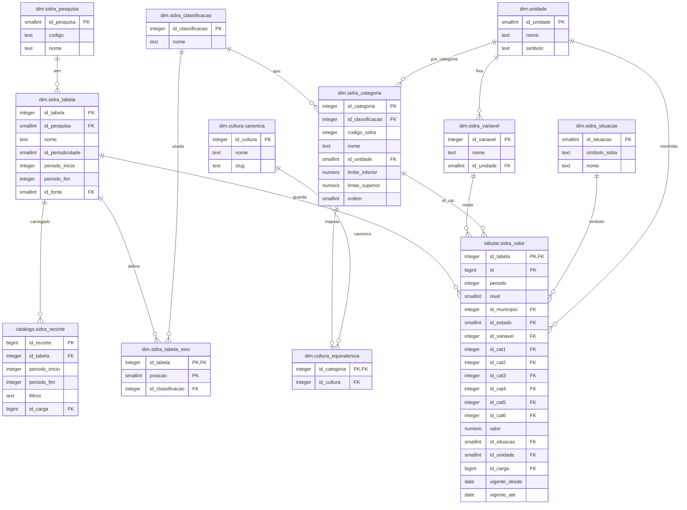

# Roadmap — Data Warehouse GIS Brasil

Última atualização: 2026-10-27 (resumo do estado atual abaixo; itens 15 e 16 de "Próximos passos": fontes novas e preparação do banco para a pré-análise de legalidade)

## Estado em 2026-10-27 (resumo)

**O que está no banco** (PostgreSQL 18 + PostGIS 3.6 em Docker, `dw-postgis`; GeoServer `dw-geoserver`; Tailscale `dw-tailscale`). Tudo em SIRGAS 2000 (4674), versão vigente = `vigente_ate IS NULL`:

| Fonte | Tabela | Vigentes | Como atualiza |
|---|---|---|---|
| INPE, PRODES (6 biomas) | `vetorial.prodes_desmatamento` | 6.936.963 | agendada (só biomas com edição nova) |
| SICAR, imóveis rurais (27 UFs) | `vetorial.sicar_imoveis` | 8.551.530 | agendada |
| MapBiomas Alerta | `vetorial.mapbiomas_alerta` | 543.378 | agendada |
| INPE, DETER (Amazônia e Cerrado) | `vetorial.deter_alertas` | 599.537 | agendada |
| FUNAI, terras indígenas | `vetorial.funai_terras_indigenas` | 665 | agendada |
| IBAMA, termos de embargo | `vetorial.ibama_embargos` | 116.944 | agendada (desde 27/10); CPF só como hash |
| ICMBio, áreas embargadas | `vetorial.icmbio_areas_embargadas` | 14.779 | agendada (desde 27/10); CPF só como hash |
| SEMA-MT, áreas embargadas e desembargadas | `vetorial.sema_mt_areas_embargadas`, `vetorial.sema_mt_areas_desembargadas` | 8.357 e 4.729 | agendada (desde 28/10); CPF só como hash |
| MTE, Cadastro de Empregadores (lista suja) | `tabular.mte_cadastro_empregadores` | 508 | agendada (desde 28/10); CPF só como hash |
| MMA, unidades de conservação (CNUC) | `vetorial.mma_unidades_conservacao` | 3.576 | **manual autorizada** (zip em `bruto/`); `--verificar` |
| SFB, florestas públicas (CNFP) | `vetorial.sfb_florestas_publicas` | 12.874 | automática, sob demanda (1 edição por ano) |
| INCRA, assentamentos | `vetorial.incra_assentamentos` | 7.525 | fonte fora do ar (item 11); carga antiga |
| IBGE, domínios e regiões naturais | `vetorial.ibge_dominios_naturais`, `ibge_regioes_naturais` | 52 e 271 | carga única |
| IBGE/SIDRA (Censo Agropecuário 2017, PAM, próximas) | `tabular.sidra_valor` (+ `dim.sidra_*`), `tabular.ibge_pam` | — | só sob demanda |
| IBGE, malha (estados, municípios), biomas | `dim.estados`, `dim.municipios`, `dim.biomas` | — | carga única |

Rasters (fora do banco, em arquivo/COG, servidos pelo GeoServer): MapBiomas uso do solo 1985/2008/2015/2025 e TOPODATA (declividade RS+SC), 8 arquivos, 11,7 GB.

**Operação:** atualização agendada (domingos alternados, 00:10) com backup antes (reaproveitado se tiver menos de 24 h) e depois, retenção de 30 dias; backup semanal de domingo 03:00;
diagrama do banco publicado como artefato (versão 10); repositório público no GitHub sincronizado; guia de uso em [GUIA_DE_USO.md](GUIA_DE_USO.md).

**Pendências principais:** (1) pré-análise de legalidade EUDR (item 16): **as fontes estão todas no banco** (11 de 12 critérios; falta o quilombola, preso ao INCRA); falta decidir a metodologia (16.3) e escrever a verificação (16.4); (2) INCRA (assentamentos, quilombolas, SIGEF) depende do servidor voltar (item 11);
(3) MinIO e catálogo de rasters (ver "Caminho 1"); (4) monitor de fontes (item 14); (5) política do Tailscale e acesso dos analistas ao PostGIS (seção "Migração"); (5b) GeoServer: ✅ as fontes novas foram publicadas em 2026-10-27 por view sem dado pessoal (`infra/LEIAME_infra.md`); (6) fontes novas do item 15 ainda não carregadas (áreas prioritárias do MMA, ANA BHO, IBGE ambientais, MapBiomas rasters automatizados).

## Objetivo

Consolidar num só lugar local os dados públicos nacionais que são usados
repetidamente em processamentos de geoprocessamento (overlay de polígono de
fazenda x uso do solo, desmatamento, declividade, etc.), pra parar de
rebaixar/reprocessar tudo a cada demanda nova.

Tudo local, nada em nuvem.

## Arquitetura decidida

- **Vetor** (SICAR — imóveis rurais, PRODES — polígonos de desmatamento) →
  **PostGIS** local. Motivo: são a base que se cruza o tempo todo com outros
  dados, precisam de índice espacial, e os resultados de overlay são dado
  tabular por natureza (junta bem com uma tabela de propriedades).
- **Raster** de grande escala, contínuo ou categórico por pixel (MapBiomas,
  elevação/declividade do TOPODATA) → **arquivo em disco** (GeoTIFF/COG),
  processado sob demanda via GDAL/QGIS (zonal statistics), não importado pro
  PostGIS raster. Motivo: leitura parcial por janela já é eficiente em
  arquivo, importar pro banco duplica dado sem ganho de performance pro
  padrão de uso ("recorta e soma por polígono").
- **Resultados de overlay** (ex.: declividade média da fazenda X, % de área
  por classe do MapBiomas, área desmatada pelo PRODES) → gravados como linhas
  no PostGIS, ligados ao `id` da propriedade. É o ponto de encontro entre os
  dois mundos.

## Visão de expansão futura

Os datasets de hoje (TOPODATA, MapBiomas, PRODES, SICAR) são só o começo. A
ideia é o data warehouse crescer continuamente conforme a demanda de
processamento pedir, então a estrutura (pastas, schema do PostGIS, catálogo)
precisa ser pensada **desde já** pra escalar, não só pro que já temos.

Camadas já previstas pra entrar (lista não-exaustiva, vai crescer). Situação em 2026-10-27:

- **Geologia, geomorfologia, pedologia, vegetação** (fonte: IBGE) — domínios e regiões naturais já no banco; o resto aguarda import
  (fonte automatizável em `geoftp.ibge.gov.br`, item 15). Ver [LEIAME_ibge.md](ibge/LEIAME_ibge.md).
- **Assentamentos rurais** (INCRA) — ✅ no banco (carga antiga); **territórios quilombolas** — ⛔ dependem do INCRA voltar (item 11).
  Os assentamentos também aparecem no CNFP do SFB. Ver [LEIAME_assentamentos.md](incra/assentamentos/LEIAME_assentamentos.md).
- **Imóveis certificados — SIGEF e SNCI** (INCRA) — ⛔ bloqueado (item 11).
- **Terras indígenas** (FUNAI) — ✅ pipeline automatizado e na atualização agendada
  ([LEIAME](funai/terras_indigenas/LEIAME_terras_indigenas.md)).
- **Unidades de Conservação/CNUC** (MMA) — ✅ no banco (carga manual autorizada, [LEIAME](mma/unidades_conservacao/LEIAME_unidades_conservacao.md));
  **áreas prioritárias pra conservação** — a carregar (item 15).
- **Florestas públicas** (SFB, CNFP) — ✅ no banco ([LEIAME](sfb/florestas_publicas/LEIAME_florestas_publicas.md)).
- **Alertas e fiscalização:** DETER (INPE) ✅, embargos do IBAMA ✅; ICMBio, SEMA-MT e lista de empregadores (MTE) a carregar (item 16).
- **Hidrografia** (Base Hidrográfica Ordinária, fonte: ANA) — a carregar (item 15); ver [LEIAME_ana.md](ana/LEIAME_ana.md).
- **Produção agrícola** (IBGE/PAM e Censo Agropecuário) — ✅ no banco (tabular), sob demanda pela camada genérica do SIDRA (item 12).
- outras camadas correlatas conforme a demanda de processamento pedir (ver itens 15 e 16 de "Próximos passos")

⚠️ **Nota (2026-10-01)**: essas 5 fontes (IBGE-temas pendentes, INCRA,
FUNAI, MMA, ANA) já estavam baixadas no disco há tempo, mas sem nenhuma
documentação nem estrutura — descobertas/organizadas só agora, ao revisar
a estrutura geral do repositório. Todas agora seguem o padrão
`bruto/processado/scripts/LEIAME` do resto do projeto, cada uma com seu
próprio LEIAME. Nenhuma tem CRS/encoding/schema verificado ainda — fazer
essa verificação no momento de importar cada uma, não antes.

### Dados tabulares (não-espaciais) também fazem parte

Nem tudo que entra no data warehouse precisa ter geometria. Dado tabular
(ex.: séries do IBGE/SIDRA, estatística agropecuária, preços, censo) também
deve ter um lugar aqui — como tabela comum no mesmo PostGIS (sem coluna de
geometria), ligável aos dados espaciais por uma chave padrão (ex.: código do
município do IBGE de 7 dígitos, ou código do imóvel do SICAR/CAR). Não tratar
tabular como "fora do escopo" só porque não é raster/vetor — ele entra na
mesma lógica de catálogo e é o que normalmente enriquece a análise espacial
(ex.: cruzar declividade da fazenda com estatística agropecuária do
município).

### Implicação de arquitetura: catálogo e nomenclatura — ✅ resolvido

**Formalizado em [ARQUITETURA.md](ARQUITETURA.md) (2026-09-27)** — schemas
por tema (`vetorial`/`tabular`/`dim`/`resultados`/`catalogo`), convenção de
nome de tabela/coluna, catálogo único (`catalogo.datasets`) cobrindo vetor,
raster e tabular numa tabela só. Não é mais uma decisão pendente — é a
referência que todo dataset novo segue.
  - **Já aplicado em `elevacao/`** (2026-09-22) como primeiro exemplo do
    padrão de pasta: cada fonte (`topodata/`, `copernicus/`) separada em
    `scripts/` (código), `bruto/<regiao>/<produto>/` (dado original, sem
    alteração) e `processado/<regiao>/` (mosaico, reprojeção, derivados).
    Scripts genéricos compartilhados ficam em `scripts_comuns/` na raiz de
    `elevacao/`. Usar esse mesmo padrão (`bruto/` → `processado/`) como
    ponto de partida pros próximos datasets raster, ajustando o que não
    fizer sentido.
  - **Mesmo padrão aplicado em `prodes/vetor/`** (2026-09-22), adaptado pra
    vetor: `bruto/<bioma>/` (GeoPackage original por fonte, sem alteração) →
    `processado/` (merges gerados, nomeados pelos biomas incluídos). Também
    serviu de precedente pra uma decisão de arquitetura: **não gerar merge
    "grande" permanente à toa** — o merge em `processado/` aqui é o rascunho
    de entrada pro futuro import no PostGIS (que será o merge "de verdade",
    vivendo no banco, não como arquivo gerenciado à mão), não um artefato
    duplicado pra sempre.

## Estado atual por dataset

### TOPODATA (elevação / declividade) — [elevacao/topodata/](elevacao/topodata/)

- [x] Fonte migrada: `dsr.inpe.br` saiu do ar, dado agora vem do STAC do
      BDC/INPE (`data.inpe.br`) — documentado em
      [LEIAME_topodata.md](elevacao/topodata/LEIAME_topodata.md)
- [x] **RS + SC baixados**: 41 folhas de altitude (ZN), reprojetadas pra UTM
      22S, declividade em graus calculada via `gdaldem slope`
- [x] Exemplo de faixa customizada (11°-22°) validado com `gdal_calc.py`
- [ ] Demais estados / Brasil inteiro — baixar por demanda, script já pronto
      (`baixar_topodata_regiao.py`, é só trocar a bbox)
- [x] **Convertido pra Int16 + COG (2026-10-01)**: `rs_sc_declividade_graus`
      (1.256 MB, era ~2,4GB) e `rs_sc_declividade_pct` (918 MB, era ~2,4GB).
      Estilo de simbologia QGIS (`.qml`, classes EMBRAPA) testado e
      confirmado funcionando. Detalhes em
      [LEIAME_topodata.md](elevacao/topodata/LEIAME_topodata.md).

### MapBiomas — [mapbiomas/](mapbiomas/)

- [x] Coleção 11 já baixada (raster Brasil inteiro, uma banda por ano —
      `brazil_coverage-col11_2025.tif`)
- [x] Decidido: **manter como raster**, não vetorizar. A 30m, land use é
      fragmentado demais — vetorizar o país geraria dezenas/centenas de
      milhões de polígonos. A pergunta típica ("% de área por classe dentro
      da fazenda") é zonal statistics, que roda direto no raster.
- [x] **Convertido pra COG (2026-10-01)**: os 4 anos (1985/2008/2015/2025)
      reprojetados de WGS84 pra SIRGAS2000/EPSG:4674 (CRS de origem era
      diferente do padrão do projeto) e convertidos pra COG
      (`gdalwarp -of COG`, reamostragem `NEAREST` obrigatória por ser dado
      categórico). Validado por amostragem de pontos reais, bateu exato
      nos 4 anos. Detalhes em [LEIAME_uso_do_solo.md](mapbiomas/uso_do_solo/LEIAME_uso_do_solo.md).
- [ ] `pastagem_vigor/` (9 tiles de Minas Gerais) — ainda não
      investigado/processado

### PRODES — [prodes/desmatamento/](prodes/desmatamento/)

- [x] Já baixado em raster (`prodes_brasil_2024_v20260407.tif`)
- [x] **Verificado direto no TerraBrasilis (2026-09-22)**:
      [downloads](https://terrabrasilis.dpi.inpe.br/downloads/) — **o vetor
      só existe por bioma, nunca "Brasil inteiro" de uma vez**. Em
      "Brasil - PRODES (Desmatamento)" só tem Geotiff + um PDF de mapa; o
      GeoPackage vetorial completo (ex.: Cerrado ~1,9GB) só aparece dentro de
      cada bioma ("Bioma Cerrado - PRODES", "Bioma Mata Atlântica - PRODES",
      etc. — 6 biomas: Amazônia, Caatinga, Cerrado, Mata Atlântica, Pampa,
      Pantanal). Pra cobertura vetorial nacional seria preciso baixar e unir
      os 6.
- [x] **Vetor: os 6 biomas baixados** (2026-09-22) em `prodes/vetor/bruto/<bioma>/`
      (~21GB descompactado no total). Motivo do vetor: interseção exata com
      `ST_Intersection`, sem ambiguidade de pixel parcial na borda da
      propriedade (melhor que raster pro overlay com fazenda).
- [x] **"Amazônia Legal" excluído de qualquer merge**: confirmado no
      metadado oficial que esse produto se sobrepõe com Bioma
      Amazônia/Cerrado/Pantanal — somar junto contaria área em dobro.
- [x] **Os 6 biomas importados pro PostGIS** (2026-09-27), tabela
      `vetorial.prodes_desmatamento` no banco `data_warehouse` —
      **6.880.431 feições, Brasil inteiro numa tabela só**. Validado:
      `COUNT(*) = COUNT(DISTINCT uuid)`, 0 geometria inválida, índices
      criados (espacial GIST + btree em `bioma` + único em `uuid`, esse
      último evita duplicata futura por acidente). Dois incidentes reais
      encontrados e corrigidos no caminho (Pantanal duplicado 4x por rerun
      de comando, 13 feições repetidas entre as camadas da Amazônia) —
      detalhes completos em [LEIAME_prodes_desmatamento.md](prodes/desmatamento/LEIAME_prodes_desmatamento.md).
- [x] **Retrofit de `id_bioma`/`id_estado` concluído e indexado (2026-09-28)**
      — `vetorial.prodes_desmatamento` agora referencia `dim.biomas` e
      `dim.estados` por FK numérica, não mais por texto. Processo caro (um
      retrofit tardio numa tabela de 6,88M linhas, complicado por um bug real
      de truncagem de coluna encontrado no meio do caminho) — detalhes e
      lições em [ARQUITETURA.md](ARQUITETURA.md), seção "Pegadinhas". A
      lição prática já virou regra pros próximos datasets: dimensão nasce
      **antes** da tabela principal, não depois.
- [ ] Decidir se mantém o raster também (útil pra QA visual/mapa de fundo) ou
      só o vetor

### SICAR — [sicar/](sicar/)

- [x] **Completo no PostGIS (2026-10-01)**: `vetorial.sicar_imoveis`,
      8.360.953 imóveis, 27 estados, `id_estado`/`id_municipio`
      referenciados desde a criação (sem retrofit tardio, diferente do
      PRODES). Estrutura já pronta pra histórico (SCD tipo 2:
      `vigente_desde`/`vigente_ate`) pra quando entrarmos na atualização
      periódica. Detalhes completos e pegadinhas encontradas (duplicata na
      origem, município sem código IBGE, bug de codificação no script) em
      [HISTORICO.md](sicar/imoveis/HISTORICO.md).
- [x] **Pipeline de atualização periódica pronto e agendado** (2026-10-23, item 13): espelho versionado (SCD2), 27 UFs, domingos alternados.
      Hoje: 8.551.530 imóveis vigentes. (Airflow não foi necessário; a tarefa agendada do Windows cumpre o papel.)

### PostGIS

- [x] **Instalado e configurado** (2026-09-27) — PostgreSQL 18 + PostGIS
      3.6 (via PostGIS Bundle installer), banco `data_warehouse`, schemas
      `vetorial` e `tabular` criados (convenção de nomenclatura por tema,
      fixada nesta etapa)
- [x] Primeira tabela real rodando: `vetorial.prodes_desmatamento` (ver
      seção PRODES acima) — pipeline vetor → PostGIS validado ponta a ponta
- [x] **Arquitetura/convenções formalizadas** (2026-09-27) em
      [ARQUITETURA.md](ARQUITETURA.md) — schemas `vetorial`/`tabular`/`dim`/
      `resultados`/`catalogo`, convenção de nome de tabela/coluna, padrão de
      auditoria (`id_fonte` como dimensão + `importado_em`), desenho do
      catálogo único (`catalogo.datasets`, com `cobertura` como geometria de
      verdade). `dim.fontes` e `catalogo.datasets` criados e populados com o
      PRODES como primeiro registro de cada. Todo dataset novo daqui pra
      frente já nasce seguindo esse padrão.
- [x] ⚠️ **Nota de ambiente**: o instalador do PostGIS Bundle registra
      `PROJ_LIB` em nível de Máquina apontando pro `proj.db` dele mesmo, o
      que conflita com o `ogr2ogr`/GDAL do QGIS (erro de versão do PROJ).
      Correção: sobrescrever `$env:PROJ_LIB` só na sessão do terminal antes
      de rodar `ogr2ogr` do QGIS, nunca mudar a variável global (o serviço
      do Postgres depende dela) — detalhes em
      [LEIAME_prodes_desmatamento.md](prodes/desmatamento/LEIAME_prodes_desmatamento.md).
- [ ] Modelar tabela de propriedades (SICAR) + tabela de resultados de
      overlay (propriedade × dataset × valor × data do processamento)
- [ ] Criar uma tabela de **catálogo de rasters** (produto, ano, bbox,
      caminho do arquivo em disco) — formaliza em SQL o que hoje fazemos
      manualmente consultando o STAC do INPE ou olhando a pasta

## Tornar o projeto replicável (portfólio público no GitHub)

> **Estado em 2026-10-27:** repositório **público no GitHub** (`PDS23/datawarehouse_dados_brasil_geo`, ramo `main`), sincronizado a cada etapa (push autorizado pelo usuário). Há `README.md`, `LICENSE` (MIT),
> `GUIA_DE_USO.md`, pipelines reexecutáveis por fonte e a pilha em Docker (`infra/`). **Falta** conferir a renderização do README no GitHub e um guia de instalação do zero. *(Histórico, 2026-10-23:)* repositório Git iniciado com **um commit local** de 104 arquivos. Feito:
> `README.md` na raiz (com o diagrama do banco), `LICENSE` (MIT; o titular está só como "Pedro": trocar pelo nome completo antes de publicar),
> `.gitignore` reforçado (sem dados, segredos, logs, infraestrutura de acesso em equipe, material interno e trabalhos de clientes) e varredura de
> segredos, e-mails e IPs nos arquivos versionados (nenhum segredo encontrado; identificadores trocados por placeholders). **Fora do repositório público,
> por decisão do usuário:** `infra/tailscale/`, `infra/colab/`, `pg_hba`, papéis de analistas, `projetos/mda` e `projetos/cecafe`, `HANDOFF_DESKTOP.md`,
> `DICAS_DESENVOLVIMENTO_VAGAS.md` e `infra/migracao/`. **Resolvido depois (2026-10-23):** autor dos commits = `Pedro Henrique da Silva` com o e-mail noreply do GitHub (o e-mail pessoal não aparece no histórico público), `.gitattributes` com fim de linha LF e `infra/LEIAME_infra.md` reescrito. `LICENSE` com o nome completo e repositório criado no GitHub (`PDS23/datawarehouse_dados_brasil_geo`). **Falta:** enviar (só quando o usuário pedir) e conferir lá a renderização do README.

Levantado em 2026-10-01: pensando em portfólio de verdade (e em levar esse
projeto pra outra empresa/carreira no futuro), a ideia é que qualquer
pessoa consiga **recriar esse data warehouse do zero**, só com o
repositório — sem depender da pasta pessoal do usuário em nuvem nenhuma
(Google Drive é só pra migração pessoal entre as duas máquinas do usuário,
não é o mecanismo de distribuição do projeto).

Isso é trabalho real, não só documentação — o que falta:

- [x] `README.md` na raiz do projeto (visão geral, requisitos, link pros
      LEIAMEs de cada fonte)
- [ ] Guia de instalação passo a passo (hoje está espalhado no
      ARQUITETURA.md) — Postgres+PostGIS (via Docker Compose, ver item
      abaixo), extensões, schemas, `dim.fontes`/`catalogo.datasets`
      iniciais
- [x] (feito: stack `infra/docker-compose.stack.yml`, PostGIS e GeoServer em Docker desde o corte para o desktop) `docker-compose.yml` — GeoServer direto em Docker (nunca instalado
      nativo, sem bagagem legada); avaliar se/quando migrar o
      PostgreSQL/PostGIS nativo pra Docker também (ver conversa de
      2026-10-01 — não migrar só por migrar, migrar quando for mesmo pro
      desktop)
- [~] Scripts de download: **feitos** para PRODES, SICAR, MapBiomas Alerta, FUNAI, DETER, IBAMA, SFB (CNFP), IBGE/SIDRA e TOPODATA; o CNUC é carga manual autorizada. **Faltam** ANA, IBGE ambientais, MapBiomas rasters e INCRA (fora do ar)
- [ ] Completar scripts de import que faltam — hoje têm script reexecutável o SICAR
      (`sicar/imoveis/scripts/atualizar_imoveis_sicar.py`, baixando do CAR), o PAM,
      o Censo Agropecuário, os assentamentos do INCRA e `dim.estados`/`dim.municipios`
      (`localidades.py`). PRODES e `dim.biomas` foram comandos soltos rodados direto no
      chat, nunca viraram script salvo/reexecutável
- [~] Licença do repositório decidida (MIT); a licença de cada fonte está em `catalogo.datasets.licenca`, e várias dizem "confirmar os termos antes de redistribuir"

## Migração notebook → desktop

Plano completo em [infra/MIGRACAO_DESKTOP.md](infra/MIGRACAO_DESKTOP.md)
(estruturado em 2026-10-05). **Ensaio e carga completa concluídos em
2026-10-06** (passos 1 a 8 do `HANDOFF_DESKTOP.md`, registrados no diário):
stack em Docker no ar, banco completo restaurado no desktop com renumeração e
validado contra o notebook (contagens idênticas), GeoServer criado do zero por
script. **Falta o corte de rede** (Passo 9): Tailscale, convites dos colegas e
troca do compose. O notebook continua servindo os colegas até lá.

- [x] Inventário do notebook rodado (2026-10-06): 28 GB, PG 18.6 / PostGIS
      3.6.2, 17 FKs; saída em `infra/migracao/inventario_notebook.txt`
- [x] Lacuna de "GeoServer como código" fechada (`publicar_geoserver.py`,
      2026-10-06) e **criação do store PostGIS do zero testada no desktop**
      (2 execuções: criou tudo, a segunda não duplicou nada)
- [ ] Política do Tailscale com alias/tag em vez de IP fixo
- [x] Desktop verificado e preparado (Ryzen 7 5700X, 32 GB, SVM ligado,
      WSL2 20 GB, Docker 29.8, `C:` 1 TB livre)
- [x] Ensaio com recorte (todas as tabelas, sem os dados das 4 grandes):
      restore em 3 seções em segundos, sem erro de codificação
      (origem UTF8 / `Portuguese_Brazil.1252`, destino UTF8 / `en_US.utf8`)
- [x] **Renumeração de `id_estado` (= `cd_uf` IBGE) e `id_bioma`
      (= `codigo_bioma` IBGE) aplicada com os dados reais no desktop:**
      7 min 21 s, 8 conferências em 0, 89 grupos de contagem idênticos antes e
      depois (com o mapeamento), SP = 35, RS = 43, AC = 12. O notebook segue
      com a numeração antiga até o corte
- [x] **Carga completa concluída e validada (2026-10-06):** dump de 6,34 GB
      puxado pela tailnet com o papel `leitura` (opção B, ~24 min),
      `data` 3 min, `post-data` 2 min; contagens idênticas ao notebook em todas
      as tabelas; referências do Acre, Acrelândia (2.374) e Ribeirão Preto
      100 km (8.451) batem. Tempos e lições em
      [infra/MIGRACAO_DESKTOP.md](infra/MIGRACAO_DESKTOP.md)
- [x] **Passo 9a concluído (2026-10-07):** contêiner Tailscale (sidecar)
      testado: nó com IP `100.x.y.z`, encaminha 8080 e 5432, o `TCPForward`
      resolve os nomes do compose, Acrelândia 2.374 pelo nó novo (do desktop e do
      notebook), conexão direta na mesma LAN, **o nó mantém IP e chave depois de
      `docker restart`** (volume `tsstate`), e o console **oferece "Share"** para
      o nó de contêiner. QGIS abriu GeoServer e PostGIS direto pelo nó novo
- [~] **Passo 9b (corte) feito pela metade, de propósito:** notebook renomeado
      `datawarehouse-antigo`, sidecar renomeado **`datawarehouse`**
      (`datawarehouse.<sua-tailnet>.ts.net`), política nova salva no console
      (alias em `hosts`; teste do dono passou), camadas de demonstração do
      GeoServer apagadas (24 → 5 camadas; `publicar_geoserver.py` ganhou a parte
      opcional `limpar_demo`), `docker-compose.yml` do notebook renomeado no
      desktop para `docker-compose.notebook.yml`. **Falta:** reaplicar a política
      com a 5432 liberada (decisão abaixo) e **compartilhar o nó com os 2
      colegas, que o usuário fará só na semana que vem**; depois alguns dias de
      uso estável antes de desligar o notebook
- [x] **Backup do banco do desktop (2026-10-07):** `infra/scripts/backup_banco.ps1`
      (`pg_dump -Fd -j 4` + `pg_dumpall --globals-only`, verificação por
      `gzip -t` e `pg_restore --list`, manifesto, retenção, `-Etiqueta` para
      backups que a retenção não apaga). Primeiro backup: 6,35 GB em ~9 min.
      **Teste de restauração passou:** restaurado em banco de outro nome em ~9 min,
      contagens e impressões digitais de ids e geometrias idênticas à produção.
      Tarefa agendada **domingo 03:00, manter 4**, em disco distinto do volume do
      Docker; backup manual com etiqueta depois de cada atualização de dados;
      cópia também no Drive **sem o `globals.sql`** (tem hashes de senha). O
      backup **não avisa se falhar** (conferir na segunda: `LastTaskResult` e
      `backup.log`). Restauração: `pg_restore -j 4` num banco `template0`/UTF8 e
      **`ANALYZE` no fim** (o `pg_restore` não roda)
- [x] **`pg_hba` endurecido e aplicado (2026-10-07):** o superusuário `postgres`
      não entra mais pela rede (só socket local, `docker exec`); `geoserver` e
      `leitura` só no banco `data_warehouse`, com senha; o resto é rejeitado
      (22 casos testados num servidor descartável). Arquivo em
      `infra/postgres/` montado fora do `PGDATA`. Resíduo: todo cliente da
      tailnet chega com o IP do sidecar, então a origem não distingue quem é quem
- [ ] **DECISÃO DO USUÁRIO (2026-10-07): manter a 5432 aberta e os 3 analistas
      usarem o PostGIS direto**, com um schema de escrita. Desenho do desktop,
      **testado em servidor descartável, não executado na produção:** schema novo
      `analises` (o `resultados` fica para o curado), grupo `analistas`,
      `statement_timeout` 30 min, 10 conexões por papel, senha provisória
      definida pelo administrador e trocada pelo analista. Pendente: nomes do
      schema e dos 3 papéis, "sim" para rodar os scripts, **reaplicar a política
      do Tailscale com a 5432 liberada antes dos convites**, documentar o schema
      em ARQUITETURA.md. Nota: isso muda o combinado anterior (convidados só na
      8080 e 5432 fechada)
- [ ] Depois do corte: remover o `GRANT SELECT` nas sequências ao `leitura` se
      quiser (inofensivo manter), `VACUUM (ANALYZE)` opcional no PRODES e no
      SICAR, `gist_index_check` opcional nos 2 GiST grandes, **tipar a coluna
      `geom` do PRODES** (`MultiPolygon,4674` nas 6.880.431 linhas, hoje
      `GEOMETRY` genérico; causa do "?" no QGIS; reescreve ~11 GB, melhor antes
      dos convites), TLS no Postgres, remover o backup `teste-exec` (6,35 GB)
      quando não precisar. (`_dump\ensaio` e `\completo` já foram apagados do
      desktop em 2026-10-07; o nó `desktop-ifjtpfh` é o outro desktop pessoal
      do usuário, não é desconhecido)
- [x] Decidido (2026-10-06): PostgreSQL/PostGIS **em Docker** no desktop
      (`postgis/postgis:18-3.6`, verificada), junto do GeoServer; avaliar
      contêiner Tailscale ("sidecar") pra compartilhar com os colegas só a
      stack, não o Windows. Desenho e cuidados em
      [infra/MIGRACAO_DESKTOP.md](infra/MIGRACAO_DESKTOP.md)

## Acesso em equipe (infraestrutura)

Ainda não iniciado. Objetivo: colegas de equipe (e notebooks Colab) acessarem
o PostGIS e os rasters hospedados neste PC, sem colocar nada na nuvem e sem
expor o PC direto pra internet aberta.

Nota: essa arquitetura foi escolhida deliberadamente mais completa que o
mínimo necessário (inclui GeoServer, não só acesso direto) — também serve
como projeto de portfólio pra vagas de Geospatial Data Engineer, então vale
priorizar a versão "padrão de mercado" mesmo dando mais trabalho de
configurar.

Existem **dois públicos diferentes**, com necessidades e soluções distintas —
não faz sentido forçar uma arquitetura única pros dois:

### Rede (base para os dois caminhos)

- [x] **Tailscale instalado e validado (2026-10-02)** no notebook (onde o
      PostGIS roda hoje) e no desktop, mesma conta pessoal, MagicDNS
      ativado. Teste de rede de outro dispositivo
      (`Test-NetConnection <ip-tailscale> -Port 5432`) deu `True`. Dispositivo
      servidor renomeado pra `datawarehouse` na tailnet: clientes devem
      apontar pro nome, não pro IP — assim a migração notebook → desktop
      vira trocar um ponteiro, não reconfigurar cada cliente. Resolução do
      nome validada do desktop (QGIS conectando com host `datawarehouse`).
      Pendente: convidar colegas pra tailnet (plano gratuito: até 3
      usuários).

### Caminho 1 — Automação (Colab/Python, uso próprio)

Quem programa e entende credencial/config diretamente. Acesso eficiente,
sem camada de serviço no meio.

- [ ] Instalar cliente Tailscale dentro do próprio notebook Colab
      (`tailscale up` com auth key) pra entrar na rede privada a partir da
      VM do Colab
- [x] **PostGIS acessível pela rede Tailscale (2026-10-02)**:
      `listen_addresses = '*'`, linha no `pg_hba.conf` liberando só a faixa
      `100.64.0.0/10` pro usuário read-only `leitura` no banco
      `data_warehouse` (o superusuário `postgres` continua só local),
      regra de firewall do Windows restrita à mesma faixa (porta 5432).
      Validado ponta a ponta: login do QGIS no desktop (outro dispositivo,
      pelo nome MagicDNS) acessando o banco. Pendente: desenho de um
      usuário por colega, agrupados num papel `leitores` (revogação
      individual, auditoria), em vez de uma senha compartilhada. A equipe SIG não precisa de senha de banco — vai pelo
      GeoServer (caminho 2). Acesso via `psycopg2` /
      `geopandas.read_postgis(...)`.
- [ ] **Raster**: subir um **MinIO** (servidor S3-compatível, local, sem
      nuvem) pra servir os COGs. GDAL/rasterio falam nativamente com S3
      (`/vsis3/`), com autenticação embutida no MinIO.
      **Não é o GeoServer** (que já temos): o GeoServer é um *servidor de mapas* (entrega imagem, feição ou valor de pixel por WMS/WFS/WCS); o MinIO seria um
      *servidor de arquivos* ("pasta na rede" com protocolo S3) que entrega o próprio COG, em pedaços, ao Python/QGIS. **Não feito de propósito** (2026-10-27): o GeoServer já
      atende a equipe SIG e, hoje, nenhuma análise real precisa ler raster pela rede (as análises em curso usam só vetor). **Decisão pendente do usuário:** manter como
      baixa prioridade, ou trocar por algo mais simples (um servidor de arquivos com suporte a `Range` lido por `/vsicurl/`, ou o próprio WCS do GeoServer) quando um notebook Colab precisar de raster.

### Caminho 2 — Equipe SIG (QGIS/ArcGIS, pouca familiaridade técnica)

Objetivo: uma experiência única e simples ("cola uma URL em Adicionar
Camada"), igual pra vetor e raster, igual no QGIS e no ArcGIS — sem
distribuir senha de banco nem credencial de S3 pra cada pessoa.

- [x] **GeoServer 2.28.2 em Docker, acessível pela tailnet (2026-10-02)**
      — ver [infra/LEIAME_infra.md](infra/LEIAME_infra.md). Porta presa
      no IP Tailscale + regra de firewall restrita à faixa
      `100.64.0.0/10` (porta 8080). Acessado e validado do desktop.
      Conexão com o Postgres via usuário read-only próprio (`geoserver`),
      sem precisar de nova linha no `pg_hba.conf` nem de regra de firewall
      (o tráfego do container chega como `127.0.0.1`). Dados de demo
      removidos, Senha Mestra trocada. Primeiras camadas publicadas
      (`dw:estados`, `dw:municipios`, `dw:biomas`, schema `dim`), com a
      chave primária exposta como atributo (`Expose primary keys`),
      senão `id_municipio`/`id_estado`/`id_bioma` somem da lista.
- [x] **Trava de segurança no WFS validada (2026-10-02)**: limite global
      de feições por requisição (`numberReturned` < `numberMatched` prova
      o corte). Valor final: 100.000. O GeoServer corta **em silêncio**:
      resultado com exatamente 100.000 feições = cortado. Documentar pros
      analistas. Complemento no WMS: tempo máximo de renderização 60 s.
      **WCS** (validado): limite de dados lidos 512 MB e gerados 256 MB
      (a medição é dentro da JVM, `-Xmx2g`, então o limite tem que ficar
      bem abaixo disso). Diferente do WFS, o WCS devolve **erro explícito**
      acima do limite, não corta em silêncio. Sem limite, um pedido do
      MapBiomas do Brasil inteiro em resolução nativa seria ~22 GB.
      Política de overviews do WCS em "Calidad" (padrão vinha em "não
      usar", o que ignora a pirâmide do COG e lê tudo em resolução total).
      Conexão Tailscale entre notebook e desktop confirmada **direta**
      (sem relay, ~6 ms), então a rede não é gargalo na LAN. Pra consumo
      WMS com cache, usar o endpoint WMTS (`/gwc/service/wmts`): o WMS
      comum do QGIS (`/wms`) não aproveita o cache de tiles.
- [ ] **Publicar as tabelas grandes** (SICAR, PRODES) sem travar o QGIS/
      ArcGIS: carregar tudo e filtrar depois é inviável. Desenho em
      avaliação: views SQL com parâmetro (município/estado/bioma, aceitando
      lista, padrão devolve vazio), recortes por filtro CQL, e no QGIS o
      *Build query* do WFS antes de adicionar. Pegadinha: PRODES não tem
      `id_municipio` e SICAR não tem `id_bioma` — esses filtros viram
      cruzamento espacial dentro da view. **Pendente de teste com um
      analista de ArcGIS** (suporte a `viewparams` não verificado).
      **Desenho revisado (2026-10-02, em andamento)** pro PRODES por
      município: **tabela-ponte** `resultados.prodes_municipio`
      (`id`, `id_prodes`, `id_municipio`, `calculado_em`), 1 linha por
      município tocado, + **view** em `vetorial` que expõe `id_municipio`
      como coluna comum (GeoServer publica como camada normal, filtro por
      chave funciona em qualquer cliente, sem `viewparams`). Escolhida em
      vez de coluna única no PRODES porque (a) o piloto no Acre mostrou
      **1,49% dos polígonos cruzando divisa** (coluna única esconderia
      esses do município vizinho) e (b) não reescreve a tabela de 16 GB.
      Piloto Acre: 77.999 polígonos, 79.159 pares, 1.160 em >1 município,
      0 sem município, 24 s. **Carga completa concluída (2026-10-05):**
      7.028.540 pares pra 6.880.422 polígonos (9 sem município),
      validada contra o piloto (Acre idêntico: 79.159 / 77.999 / 1.160),
      índices, FKs e `ANALYZE` feitos, view `vetorial.v_prodes_municipio`
      criada, legível por `geoserver` e `leitura`, filtro por município em
      ~0,2 s. SQL em
      [construir_ponte_municipio.sql](analises/ponte_prodes_municipio/scripts/construir_ponte_municipio.sql).
      **Pendente**: publicar no GeoServer (store `dw_vetorial`; camadas
      `v_prodes_municipio` e `sicar_imoveis`, com os estilos de escala
      mínima em `infra/estilos/`), testar o filtro por `id_municipio` com
      o colega de ArcGIS, e fazer o mesmo pra SICAR × bioma (SICAR não tem
      `id_bioma`; imóvel pode cruzar bioma, então também é ponte).
- [x] **Configuração do GeoServer virou código (2026-10-06):**
      [infra/scripts/publicar_geoserver.py](infra/scripts/publicar_geoserver.py)
      (substitui o `publicar_rasters.py`) sobe workspace, 5 estilos, 2 stores,
      5 camadas vetoriais, 6 rasters e os limites WFS/WMS/WCS. Idempotente;
      rodar tudo contra o servidor em uso não mudou nenhum valor. Camada
      vetorial e workspace novos testados com objetos temporários. **A criação do
      store PostGIS do zero foi testada no desktop em 2026-10-06** (GeoServer
      vazio, `GEOSERVER_DB_PASSWORD` válida, 2 execuções). Limites conferidos:
      WCS leitura 524288 (o "54288" digitado antes não foi gravado), saída
      262144, WFS 100000, WMS 60 s.
- [x] **Rasters publicados (2026-10-02)** como **WMS** (visual) + **WCS**
      (valor real do pixel): MapBiomas 1985/2008/2015/2025 (estilo com as
      33 classes oficiais) e TOPODATA declividade em graus e % de RS+SC
      (classes EMBRAPA). Feito por script via REST API
      ([infra/scripts/publicar_geoserver.py](infra/scripts/publicar_geoserver.py)),
      idempotente, com estilos convertidos dos `.qml` do projeto
      ([qml_para_sld.py](infra/scripts/qml_para_sld.py)). GeoServer lê os
      COGs direto do disco montado no container, sem MinIO — que fica só
      pro caminho 1 (automação Python/Colab). Pendente: altitude (ZN) do
      TOPODATA (hoje só VRT, nunca virou COG), `pastagem_vigor`, e avaliar
      dimensão de tempo (slider por ano) em vez de 1 camada por ano.
      Lembrete: valores do TOPODATA são **escalados** (graus×100, %×10);
      o WCS devolve o número escalado. Validado no QGIS do desktop (WMS
      com estilo e WCS), e o `DescribeCoverage` das 6 camadas responde nas
      3 versões do WCS (1.0.0, 1.1.1, 2.0.1). Lição: camada criada pela
      tela com "Detalhes de Cobertura de Banda" editado quebrou o WCS
      1.1.1/2.0.1; as criadas pelo script funcionam — ver
      [infra/LEIAME_infra.md](infra/LEIAME_infra.md).
- [ ] Cada dataset novo que entrar no data warehouse precisa ser "publicado"
      no GeoServer (trabalho pontual de quem administra, não da equipe):
      acrescentar uma linha em `VETORIAIS`/`RASTERS` (e o SLD em
      `infra/estilos/`) no `publicar_geoserver.py` e rodar o script

Motivo de não dar acesso direto (PostGIS/MinIO) pra essa audiência: no
ArcGIS, conexão direta a um PostGIS "puro" (fora do esquema de Enterprise
Geodatabase da Esri) historicamente é mais rasa/trabalhosa; e configurar
credencial de S3 manualmente em cada máquina da equipe é mais um tipo de
credencial pra distribuir/gerenciar/revogar por pessoa. WFS/WMS/WCS
resolvem isso com uma única URL, sem credencial de banco ou de S3 espalhada.

⚠️ **Ressalva operacional**: isso transforma este PC num servidor pro time —
só funciona com ele ligado, acordado e com rede estável. Se virar
dependência do dia a dia da equipe, reavaliar se compensa uma máquina
dedicada só pra isso (ainda local/on-prem, não precisa ser nuvem, só
"sempre ligada").

## Decisões técnicas registradas

### Vetor vs. raster: por que não vetorizar tudo pro PostGIS

Regra usada: se a pergunta é naturalmente sobre feições discretas/legais
(propriedade, incremento de desmatamento) → vetor, PostGIS. Se é uma
grandeza contínua ou classificada por pixel cobrindo uma área enorme
(elevação, declividade, uso do solo) → raster, arquivo em disco, processado
sob demanda.

### Formato de raster: por que Float32 pesa tanto

Testado em amostra real (6000×6000px do mosaico de declividade RS+SC,
2026-09-21):

| Formato | Tamanho | vs. bruto |
|---|---|---|
| Float32 sem compressão | 144 MB | 100% |
| Float32 + DEFLATE (o que usamos hoje) | 128 MB | 89% |
| Float32 + DEFLATE + PREDICTOR=3 | 115 MB | 80% |
| **Int16 escalado (grau×100) + DEFLATE + PREDICTOR=2** | **50,6 MB** | **35%** |

Conclusão: o predictor de ponto flutuante sozinho ajuda pouco (~10%) em
terreno com relevo real (não é um ganho garantido tipo "sempre funciona bem",
depende de quão plana é a área). O ganho grande vem de **trocar o tipo de
dado** de Float32 pra Int16 escalado — ~2,5-3x menor, sem perda prática de
precisão (0,01° de resolução é irrelevante pra declividade de propriedade
rural). Aplicado ao arquivo real (2,5GB), estimativa de ~870MB-1GB.

Essa conversão **ainda não foi feita** nos arquivos de RS/SC — só testada em
amostra. Fazer com `gdal_calc.py` (não com `-scale` simples do
`gdal_translate`, que não trata nodata corretamente).

### COG (Cloud Optimized GeoTIFF): não é compressão, é organização

- COG = GeoTIFF tiled + overviews (pirâmides internas) + layout otimizado
  pra leitura parcial. **Não é uma técnica de compressão** — a compressão
  (DEFLATE, predictor, tipo de dado) funciona igual dentro ou fora do COG.
- Os overviews embutidos **aumentam** o tamanho do arquivo (~10-30% a mais),
  porque guardam cópias em resolução menor pra zoom rápido.
- O ganho do COG é de **usabilidade**, não de espaço: abre instantâneo no
  QGIS em qualquer zoom, e zonal statistics lê só a janela necessária sem
  decodificar o arquivo inteiro.
- **Atualização (após decidir dar acesso em equipe/Colab, ver seção "Acesso
  em equipe")**: o benefício mais forte do COG — leitura parcial via
  HTTP/S3 range request, sem baixar o arquivo inteiro — deixa de ser
  irrelevante assim que os rasters passam a ser servidos pela rede (MinIO)
  pra equipe. Um colega ou notebook Colab abrindo o raster via
  `/vsis3/`/`rasterio.open()` só puxa os bytes da janela que precisa, em vez
  de baixar o GeoTIFF inteiro. Isso reforça a decisão de virar COG de
  verdade (não só tiled), combinado com o Int16 (arquivo menor E leitura
  parcial eficiente pela rede).
- Decisão: adotar o perfil COG (tiled + overviews) tanto por usabilidade
  local quanto — agora com mais peso — por eficiência de acesso remoto via
  MinIO. Independente da decisão de tamanho (Int16); as duas juntas dão o
  melhor resultado.

### PostGIS vs. GeoParquet: por que o núcleo continua sendo PostGIS

Dúvida levantada em 2026-09-28, motivada pela demora real do retrofit de
`id_estado`/`id_bioma` em `prodes_desmatamento` (ver ARQUITETURA.md, seção
"Ordem de trabalho: dimensão antes de fato"): será que GeoParquet não seria
um caminho melhor que PostGIS hoje em dia?

Conclusão: **não são concorrentes, resolvem problemas diferentes** — a
demora foi um erro de processo (retrofit tardio numa tabela já grande), não
uma limitação do PostGIS em si.

- **PostGIS** = banco relacional de verdade: integridade referencial (o
  padrão `dim.*` + FK que já é a espinha dorsal da arquitetura), múltiplos
  usuários lendo/escrevendo ao mesmo tempo, transações, e é o que vai
  alimentar o GeoServer na seção "Acesso em equipe". Continua sendo o núcleo
  do data warehouse.
- **GeoParquet** = formato de arquivo colunar, ótimo pra leitura analítica em
  massa (DuckDB/Polars), zero servidor rodando — mas sem FK/integridade
  referencial e sem update em linha (reescreve o arquivo inteiro). Não serve
  como "fonte da verdade" multiusuário.

**Prioridade subida em 2026-10-02 (era "baixa, sem urgência")**: exportar
tabelas do PostGIS (ex.: `vetorial.prodes_desmatamento`,
`vetorial.sicar_imoveis`) como GeoParquet, como **camada de
análise/distribuição** adicional, no mesmo espírito do COG pro raster — não
substitui o PostGIS, complementa. Ganhou um caso de uso concreto:

- Camadas grandes (PRODES, SICAR) travam o QGIS/ArcGIS quando servidas por
  WFS (GML em texto, baixa tudo antes de qualquer filtro). GeoParquet é
  colunar e lê só o pedaço necessário.
- O **ArcGIS Pro 3.5+ suporta GeoParquet nativamente** (conexão de pasta e
  de armazenamento em nuvem, DuckDB incluso). É a forma de entregar camada
  grande pra analista de ArcGIS, que sofre mais com PostGIS direto.
- QGIS lê via GDAL (driver Parquet), mas **depende do build do GDAL** —
  testar no QGIS da equipe antes de prometer.

Pendente quando entrarmos na fase de ferramentas (a infra vem primeiro):
definir se o GeoParquet vai particionado por estado/município (casa com as
chaves `id_estado`/`id_municipio`) e como entra no catálogo
(`catalogo.datasets`, `caminho_arquivo`). Também segue sendo item de
portfólio (banco relacional + formato cloud-native).

## Próximos passos (ordem sugerida)

1. ~~Confirmar e executar a conversão Int16 + COG nos arquivos de RS/SC já
   gerados~~ — feito (2026-10-01, ver seção TOPODATA)
2. ~~Montar o PostGIS local~~ — feito (2026-09-27): PostgreSQL 18 + PostGIS
   3.6 instalados, `data_warehouse` criado, arquitetura formalizada em
   [ARQUITETURA.md](ARQUITETURA.md), PRODES rodando como primeiro dataset
   completo (dado + `dim.fontes` + `catalogo.datasets`).
3. ~~Baixar SICAR e importar pro PostGIS~~ — feito (2026-10-01) e agendado (item 13)
4. ~~Baixar o PRODES vetorial dos biomas Mata Atlântica + Pampa~~ — feito e
   validado, depois **expandido pros 6 biomas** (2026-09-27, ver seção
   PRODES). Falta decidir se o raster Brasil-inteiro já baixado é mantido
   também ou só o vetor.
5. ~~Decidir convenção de nomenclatura/schema/catálogo~~ — feito (ver
   ARQUITETURA.md)
6. Expandir TOPODATA pra outros estados/Brasil inteiro conforme a demanda
   chegar (script já pronto)
7. ~~Revisar MapBiomas: vale re-tile + overviews (perfil COG)?~~ — feito
   (2026-10-01, ver seção MapBiomas)
8. Configurar acesso em equipe (ver seção "Acesso em equipe"; Tailscale, PostGIS pela rede, GeoServer e papéis de analistas ✅; **MinIO pendente de decisão**):
   - Tailscale (rede, base dos dois caminhos)
   - Caminho automação: `pg_hba.conf`/usuário read-only (PostGIS) + MinIO
   - Caminho equipe SIG: instalar GeoServer e publicar WFS (vetor) +
     WMS/WCS (raster)
9. Ir incorporando as demais camadas conforme a demanda de processamento pedir, seguindo a convenção do ARQUITETURA.md. **Em andamento** pelos itens 15 e 16
   (já entraram FUNAI, DETER, IBAMA, CNUC e CNFP; seguem ICMBio, SEMA-MT, MTE, áreas prioritárias do MMA, ANA, IBGE ambientais e rasters do MapBiomas)
10. Avaliar estrutura de schema pra reduzir o tamanho do banco (levantado em
    2026-10-01, com o banco em ~19GB e o SICAR ainda carregando) — avaliar
    quando tiver mais dado real carregado (SICAR completo + mais camadas do
    IBGE), não especulando agora. Possíveis frentes a considerar na hora:
    simplificação de geometria por nível de zoom/uso, particionamento de
    tabelas grandes (`prodes_desmatamento`, `sicar_imoveis`) por bioma/estado
    ou por `vigente_ate`, e arquivamento de versões antigas do SCD2 do SICAR
    fora da tabela principal.
11. **SIGEF / SNCI (imóveis certificados pelo INCRA)** — ⛔ **bloqueado em 2026-10-23: o canal público do desenho
    desapareceu.** O host `acervofundiario.incra.gov.br` (WFS i3Geo, base deste item e do pipeline dos assentamentos) deixou de
    resolver no DNS (NXDOMAIN no resolvedor local e no 8.8.8.8; funcionava em 2026-10-20), embora a página oficial do gov.br
    (modificada em 15/12/2025) ainda o cite. `certificacao.incra.gov.br` e `sigef.incra.gov.br` respondem, mas o SIGEF agora diz
    que **consultas públicas exigem login gov.br de conta prata ou ouro** (o `export_shp.py` do certificacao exigia login gov.br
    antes) e o WAF recusa acesso automatizado: não automatizável. **Causa provável (informada pelo usuário e confirmada em notícias de 21-22/10/2026): falhas críticas no PHP (CVE-2026-109618/109619, "PHP2Shell") levaram governos, incluindo órgãos brasileiros, a tirar sistemas PHP do ar de forma preventiva; o i3Geo do INCRA é PHP, mas nenhuma fonte cita o INCRA, e o DNS sumir é mais radical que uma página em manutenção. Provavelmente volta depois do patch.** Decisão pendente do usuário (aguardar o INCRA, baixar os
    shapefiles à mão com a conta dele, ou outra fonte). O pipeline `incra/assentamentos` depende do mesmo host. Abaixo, o
    levantamento de 2026-10-20 (feito com o WFS no ar). O que já se sabe:
    - **Canal público, sem login:** o mesmo WFS do Acervo Fundiário que já usamos
      nos assentamentos (`https://acervofundiario.incra.gov.br/i3geo/ogc.php`),
      com quatro camadas por UF: `certificada_sigef_particular_<uf>`,
      `certificada_sigef_publico_<uf>`, `imoveiscertificados_privado_<uf>` e
      `imoveiscertificados_publico_<uf>` (as duas últimas são o SNCI digitalizado).
      Exemplo de volume: AC 5.550 / 869 / 172 / 65; PR 167.822 / 7.708 / 1.968 / 15;
      MT 99.574 / 12.450 / 7.288 / 106.
    - **Atualidade:** a camada do SIGEF recebe aprovações todo mês (registro mais
      recente de 19/10/2026 em AC, RR e PR). O servidor não informa data de
      atualização da camada; a frescura só se prova pelas datas dos registros.
    - **Normas:** a 1ª (manual) não está online; online ficam o SNCI digitalizado (2ª)
      e o SIGEF (3ª). O que só foi certificado na norma manual não tem camada.
    - **Decisão de desenho (a confirmar):** o banco deve ser **espelho** do SIGEF
      online. **Não** atualizar "só para frente por data": desmembramento e
      retificação não geram data nova na parcela original, e as parcelas novas
      entrariam sobrepostas. Reconciliar a UF inteira pela `parcela_codigo`;
      parcela que sumiu da camada tem a versão **fechada** (`vigente_ate`), numa
      view "atual" idêntica ao SIGEF online (a proposta é fechar, não apagar, para
      manter o histórico; limpeza das versões fechadas só com o "sim" do usuário).
      Trava de segurança: só fechar se o total baixado bater com o anunciado e a UF
      não perder mais de ~10% das parcelas numa rodada.
    - **Cuidados:** as quatro camadas devem ficar **separadas, com a origem marcada**
      (SNCI e SIGEF se sobrepõem quando um imóvel é recertificado); o servidor do
      INCRA já falhou numa camada (assentamentos do Pará), então o pipeline precisa
      avisar UF que falhar; uso comercial vedado pelo servidor; `rt`, `art` e
      `registro_matricula` identificam o responsável técnico e a matrícula.
    - **Antes de construir:** (1) o usuário esclarecer as normas e o que cada camada
      representa; (2) teste de leitura da sobreposição no Acre (tabelas temporárias);
      (3) ~~definir o prazo das versões fechadas~~ — decidido em 2026-10-21: **1 ano**, como
      variável única em `infra/retencao.yaml` (`dias_removidas_padrao: 365`); (4) começar
      pelo Acre, sob demanda, com `--simular`. **Previsto para 2026-10-22**, junto com a
      camada genérica do SIDRA (item 12).
12. **Camada genérica do SIDRA (Censo Agropecuário, PAM, LSPA e as próximas pesquisas)** — 📐
    **desenho aprovado em 2026-10-21; **aplicado em 2026-10-23 (passos 1 a 4)**: camada, pipeline `ibge/sidra/scripts/sidra.py`, Censo 6956 recarregado, conferido e trocado pela visão. Passo 5 feito em 2026-10-23 (cultura canônica e equivalência; **a PAM não teve os ids trocados**: o id canônico é o próprio código c782, ver `ibge/sidra/HISTORICO.md`). Faltam: retenção de `tabular.sidra_valor` (chave composta) e LSPA (passo 6).
    - **Por quê (levantamento pela API oficial do IBGE):** o Censo Agropecuário tem **1.407 tabelas**
      no SIDRA (735 do Censo 2017, 497 delas com município; 554 de 2006; 100 de 1995/96). Há 1.175
      combinações distintas de eixos para 1.406 tabelas (1.083 únicas), só 192 classificações
      (1.889 categorias) reaproveitadas, 882 variáveis e 291 variáveis com unidade que depende da
      categoria. O teto de células das tabelas de 2017 com município tem mediana de 59 milhões
      (soma de 173 bilhões): nunca carregar tudo, **sempre sob demanda, por tabela e por recorte**.
      Uma tabela tipada por tabela do SIDRA (o que existe hoje para a 6956) não escala. A tabela
      6956 tem 12 variáveis e carregamos 2 (contagens de estabelecimentos), com a tipologia fixa no Total.
    - **Decisão:** opção **C, híbrida**: uma **camada genérica** (1 pipeline, sem DDL novo por tabela,
      cada tabela do SIDRA numa partição própria) + **views tipadas por tema** para o analista
      (a view do Censo devolve as mesmas colunas de hoje). Regra do usuário: **ids em vez de texto**
      (local por `id_municipio`/`id_estado`; variável, categoria, unidade e situação por dimensões).
    - **Tabelas** (dimensões em `dim`, valores em `tabular`, recorte em `catalogo`): `tabular.sidra_valor`
      (particionada por `id_tabela`; `periodo`, `nivel` 1/3/6, `id_municipio`, `id_estado`, `id_variavel`,
      `id_cat1..id_cat6`, `valor`, `id_situacao`, `id_unidade`, `id_carga`, `vigente_desde/ate`),
      `dim.sidra_pesquisa`, `dim.sidra_tabela`, `dim.sidra_tabela_eixo` (diz que classificação cada
      `id_catN` representa em cada tabela), `dim.sidra_classificacao`, `dim.sidra_categoria` (id nosso;
      com `limite_inferior/superior` para faixas e `id_unidade` quando a unidade depende da categoria),
      `dim.sidra_variavel`, `dim.unidade`, `dim.sidra_situacao` (`-` zero, `X` sigilo, `...` não se aplica),
      `catalogo.sidra_recorte` (o que exatamente foi carregado de cada tabela) e, para juntar PAM, Censo
      e LSPA, a **cultura canônica**: `dim.cultura` (id nosso) + `dim.cultura_equivalencia`
      (`id_categoria` → `id_cultura`). Hoje PAM (c782) e Censo (c227) usam códigos diferentes para a mesma
      cultura (laranja 40151 × 4961; sem nenhum id em comum).
    - **O que muda no que existe:** `dim.produto_censo_lavoura_perm` e `dim.grupo_area_total` são absorvidas por
      `sidra_categoria`; `tabular.ibge_censoagro2017_estab_lavoura_perm` vira uma view; a `dim.cultura` atual
      (códigos da PAM) vira a canônica, o que **troca os ids das 238 mil linhas da PAM** (backup com etiqueta e
      "sim" antes). A PAM **não migra agora** para a camada genérica (funciona); o LSPA (só UF, mensal, ano da
      safra) já nasce nela. A migração da PAM é avaliada depois, quando a camada estiver provada.
    - **Escolhas do desenho** (aprovadas): 6 colunas de categoria (o máximo visto no Censo; PAM e LSPA usam 2);
      versões no valor (`vigente_desde/ate`), porque o IBGE revisa anos anteriores; níveis município, UF e Brasil
      (outros níveis só quando pedirem); dimensões em `dim`, valores em `tabular`.
    - **Diagrama (Mermaid, renderiza no GitHub):**

    - **Ordem de aplicação:** (1) backup com etiqueta; (2) dimensões e tabela de valores (SQL em
      `ibge/sidra/sql/`, pasta nova no padrão de fontes); (3) pipeline único (`ibge/sidra/scripts/`,
      config por tabela); (4) recarregar a 6956 do Censo 2017 pela camada nova e conferir contra a tabela
      atual (mesmas contagens) antes de trocar pela view; (5) cultura canônica + equivalência e migração
      dos ids da PAM; (6) LSPA direto na camada. Nada disso é carregado sem pedido: sob demanda.
13. **Frequência de atualização periódica (SICAR, PRODES, MapBiomas Alerta...)** — ✅ **agendada em 2026-10-23.**
    Tarefa do Windows "DW - Atualizacao das fontes": **domingo às 00:10, a cada 2 semanas** (14 dias: o mais próximo de "15 em 15" que cabe
    num domingo fixo; primeira execução em 2026-10-25), com o usuário logado e o Docker ligado (se o PC estiver desligado, roda ao ligar).
    Roda `infra/scripts/atualizar_fontes.ps1`: **backup antes** (local; reaproveita um backup completo de menos de 24 h, como o das 00:10; se falhar, nada é atualizado), PRODES (só biomas com edição nova), MapBiomas
    Alerta, FUNAI, DETER (incluído em 2026-10-26), IBAMA embargos (incluído em 2026-10-27), ICMBio áreas embargadas (idem), SEMA-MT e MTE (incluídos em 2026-10-28), SICAR (27 UFs), a **retenção com `--apagar`** e **backup depois** (com cópia para o Drive). O backup agendado de domingo às 03:00
    (`DW-Backup-Domingo-3h`) passou a usar `-PularSeRecenteHoras 6` e não duplica nos domingos de atualização. (Correção de 2026-10-25: a primeira execução abortou por um bug no retorno da função de backup.) A retenção (30 dias nos dois prazos, `infra/retencao.yaml`; trava de 20% por tabela). Falha de uma fonte não derruba as outras:
    fica em `catalogo.cargas` e em `infra/logs/`. **SIDRA, CNUC e CNFP continuam fora da agenda (sob demanda ou 1 edição por ano); INCRA (assentamentos e SIGEF) entra quando o servidor
    do Acervo Fundiário voltar** (item 11). Criar/alterar/remover a tarefa: `infra/scripts/registrar_tarefa_atualizacao.ps1` (`-Remover`).
    Não usa `--aceitar-queda`: fonte que entregar muito menos que o banco não é gravada e aparece como falha para conferência.
14. **Monitor de atualização das fontes + dashboard (baixa prioridade, a fazer)** — um script leve que só
    consulta *quando cada fonte foi atualizada* e compara com o que o banco tem em `catalogo.coletas`,
    sem baixar dado nenhum. Mostra num painel, por fonte: edição/data na origem, data da nossa última carga,
    defasagem e status (em dia / defasada / fonte fora do ar). Desenho provisório: uma tabela
    `catalogo.monitor_fontes` (fonte, consultado_em, versao_na_origem, data_na_origem, carregada_aqui, status),
    um script por fonte com a mesma função (PRODES: catálogo JSON do TerraBrasilis, que já usamos no
    `--verificar`; SICAR e MapBiomas: contagem total do WFS, 1 pedido de ~17 s; SIDRA: data da última
    atualização da tabela nos metadados; SIGEF/INCRA: a definir), um artefato de dashboard lendo essa tabela.
    Roda leve (segundos por fonte), então diário ou semanal cabe; a frequência entra na decisão do item 13.
    Só observa: **não carrega nada** (a carga continua sob demanda, regra coleta só sob demanda).
    Pasta no padrão: `infra/monitor/` (config.yaml com as fontes, scripts/, sql/).

15. **Levantamento de novas fontes automatizáveis (2026-10-23)** — pesquisa só de leitura (CKAN, WFS, listagens, cabeçalhos HTTP; nada baixado além de
    amostras), feita com a regra de que **dado novo só entra por automação direto da fonte**. Resultado:
    | Fonte | Automatizável? | Canal verificado | Observações |
    |---|---|---|---|
    | **FUNAI, terras indígenas** | ✅ **feita** | WFS aberto `geoserver.funai.gov.br` | 665 terras; `count` obrigatório (403 sem ele); intermediária TLS em `dwlib/certs/` |
    | **DETER (INPE), Amazônia e Cerrado** | ✅ **feito 2026-10-25** | `vetorial.deter_alertas` (599.537 linhas, espelho versionado), `deter/alertas/`; SHAPE-ZIP por mês de publicação | o `gid` da fonte não é único: chave composta (`chave_linha`); entra na atualização agendada (decidido em 2026-10-26) |
    | **IBAMA, embargos** | ✅ **feito 2026-10-26** (`vetorial.ibama_embargos`, 116.944 termos; `ibama/embargos/`; CPF só como hash; entra na atualização agendada (decidido em 2026-10-27)) | CKAN `dadosabertos.ibama.gov.br` → CSV no armazenamento do IBAMA (`termo_de_embargo.csv` 210 MB, coluna `GEOM_AREA_EMBARGADA`; `..._coordenadas.csv` com vértices), atualizado diariamente | traz nome e CPF/CNPJ de embargados (dado pessoal: decidir o que guardar); o SHP-ZIP anunciado no CKAN dá 404 hoje |
    | **MMA, áreas prioritárias para conservação** | ✅ | CKAN `dados.mma.gov.br`: 7 zips de shapefile por bioma (edição 2022) | base estática, carga única automatizada |
    | **MMA, unidades de conservação (CNUC)** | ✅ **feito 2026-10-27** | zip do shapefile **baixado à mão pelo usuário** (SharePoint do MMA; CKAN só tem link direto até `2025_08`); `vetorial.mma_unidades_conservacao`, 3.576 UCs (edição 2026_07), `mma/unidades_conservacao/` | **carga manual autorizada**; `--verificar` avisa quando o CKAN publicar link direto |
    | **SFB, Cadastro Nacional de Florestas Públicas** | ✅ **feito 2026-10-27** (`vetorial.sfb_florestas_publicas`, 12.874 polígonos, edição 2025; `sfb/florestas_publicas/`; automático CKAN → zip do portal ArcGIS; fora da atualização agendada até o usuário decidir) | item público do portal ArcGIS (`mapas.florestal.gov.br`, Shapefile 2025, zip público) + CSV no CKAN `dados.florestal.gov.br` | edições anuais (2025 publicada em 07/2026) |
    | **ANA, Base Hidrográfica (BHO 2017)** | ✅ | geonetwork do SNIRH: GPKG direto por camada (`metadados.snirh.gov.br/files/<id>/...gpkg`), uns 3 GB | base estática (2017) |
    | **IBGE, geologia, geomorfologia, pedologia, vegetação** | ✅ | `geoftp.ibge.gov.br/informacoes_ambientais/` (listagem de diretórios) | edições estáticas; carga única |
    | **IBGE, base de indígenas e quilombolas (2019)** | ✅ | `geoftp.ibge.gov.br/organizacao_do_territorio/tipologias_do_territorio/...` | é a base do IBGE, **não a do INCRA**: não substitui o INCRA |
    | **MapBiomas, uso do solo (rasters)** | ✅ | bucket público do Google Cloud `mapbiomas-public` (`initiatives/brasil/collection11/lulc/coverage` e `transition`) | cobre a lacuna "sem script" dos rasters |
    | **INCRA (assentamentos, quilombolas, SIGEF/SNCI)** | ❌ **bloqueado** | `acervofundiario.incra.gov.br` segue fora do DNS; SIGEF exige gov.br prata/ouro | ver item 11; alternativa parcial para quilombolas: base do IBGE |
    | **ICMBio, áreas embargadas** (pesquisado 2026-10-27) | ✅ | FeatureServer público `services3.arcgis.com/KYEMegXJrTiWSYWk/.../areas_embargadas_icmbio` (mesma conta do painel linkado em `gov.br/icmbio/.../areas-embargadas`); 14.779 polígonos, editado em 06/10/2026; `maxRecordCount` 2000 (paginar) | traz `cpf_cnpj` e `autuado` (dado pessoal: mesma decisão do IBAMA), `numero_ai`, `nome_uc`, `cnuc` |
    | **SEMA-MT, áreas embargadas e desembargadas** (pesquisado 2026-10-27) | ✅ | WFS `geo.sema.mt.gov.br/geoserver/Geoportal` (`AREAS_EMBARGADAS_SEMA`, 8.357; `AREAS_DESEMBARGADAS_SEMA`), SHAPE-ZIP/CSV; a `authkey` é a pública publicada no GeoNetwork da SEMA (`geonetwork.sema.mt.gov.br`): ler do catálogo a cada execução, não fixar | traz `NOME` e `CPF_CNPJ`; o WFS sem `authkey` não lista camadas |
    | **MTE, Cadastro de Empregadores (lista suja do trabalho escravo)** (pesquisado 2026-10-27) | ✅ | CSV estável `gov.br/trabalho-e-emprego/.../areas-de-atuacao/cadastro_de_empregadores.csv` (latin1, `;`); `HEAD` dá 403, `GET` funciona | tabular, sem geometria; chave `CNPJ/CPF`; atualização semestral; há também o cadastro de empregadores em ajustamento de conduta (TAC) |
    Ainda **não pesquisados**: ANM (mineração), SPU, ZEE estaduais.
    *(2026-10-27: SFB/CNFP, CNUC, IBAMA e DETER já carregados; os demais ✅ "automatizáveis" seguem a fazer. ICMBio, SEMA-MT e MTE, abaixo, entram pelo item 16.)*

16. **Preparar o banco para uma pré-análise de legalidade EUDR no Brasil (levantamento de 2026-10-27; a executar)** — 📐 desenho a aprovar. **Situação (2026-10-27):** 11 dos 12 critérios já têm a fonte no banco (itens 1 a 11); falta só o quilombola (12, bloqueado pelo INCRA).
    **Objetivo:** o banco ter todas as fontes públicas que uma checagem prévia de imóveis contra o Regulamento Europeu de Desmatamento
    (EUDR, Reg. UE 2023/1115) usa, para barrar **antes do envio** os imóveis que seriam negados. **Regra do usuário:** as fontes entram como
    qualquer outra, no padrão `<grupo>/<fonte>/` e com **nome pela fonte**; nada no banco (schema, tabela, coluna, LEIAME de fonte) cita
    EUDR nem legalidade. A análise em si é derivada, só sob demanda, e fica fora das tabelas de fonte (regra 4).
    **Referência usada:** um relatório comercial de verificação de protocolo EUDR (Serasa Experian, Agro Report) que o usuário trouxe, com 12
    critérios eletrônicos sobre bases públicas. O PDF é confidencial de terceiro: **não entra no repositório nem no Drive**; aqui fica só a
    lista de critérios. A coleta das fontes novas é feita pela conversa que automatiza a busca de fontes (item 15); este item só registra o
    que foi descoberto e o caminho.

    **16.1 Critérios de referência × o que o banco já tem**
    | # | Critério (desmatamento ou legalidade) | Fonte | No banco? | Colunas que servem / observação |
    |---|---|---|---|---|
    | 1 | Sem PRODES depois de 31/12/2020 | INPE, PRODES | ✅ `vetorial.prodes_desmatamento` | `year`, `image_date`; ver 16.3 (ano PRODES vai de agosto a julho) |
    | 2 | Sem alerta MapBiomas depois de 31/12/2020 | MapBiomas Alerta | ✅ `vetorial.mapbiomas_alerta` | `detected_at`, `status_name='published'` (mesmo filtro do CECAFÉ) |
    | 3 | CAR ativo ou pendente | SFB, SICAR | ✅ `vetorial.sicar_imoveis` | `ind_status`, `des_condic`; a geometria do imóvel vem daqui |
    | 4 | Sem sobreposição com terra indígena | FUNAI | ✅ `vetorial.funai_terras_indigenas` | `fase_ti` (decidir se "em estudo" conta) |
    | 5 | Sem sobreposição com unidade de conservação | MMA, CNUC | ✅ `vetorial.mma_unidades_conservacao` | `grupo`, `categoria`: produção agrícola só é admitida em APA (uso sustentável) |
    | 6 | Sem sobreposição com embargo do IBAMA | IBAMA | ✅ `vetorial.ibama_embargos` | `sit_desembargo`, `sit_cancelado` (excluir os já desembargados/cancelados) |
    | 7 | CPF/CNPJ fora da lista de embargos do IBAMA | IBAMA | ✅ mesma tabela | `cpf_cnpj_embargado` (CNPJ) e `cpf_embargado_hash` (CPF de PF, HMAC) |
    | 8 | Sem sobreposição com embargo do ICMBio | ICMBio | ✅ `vetorial.icmbio_areas_embargadas` | 14.779 polígonos (278 sem geometria, 444 inválidos); `julgamento`, `data_embargo` |
    | 9 | CPF/CNPJ fora da lista de embargos do ICMBio | ICMBio | ✅ mesma tabela | `cpf_cnpj` (CNPJ) e `cpf_autuado_hash` (CPF, mesma chave do IBAMA) |
    | 10 | Sem sobreposição com embargo da SEMA-MT | SEMA-MT | ✅ `vetorial.sema_mt_areas_embargadas` (+ `..._desembargadas`, embargo encerrado) | 8.357 e 4.729 polígonos; só vale para Mato Grosso |
    | 11 | CPF/CNPJ fora da lista suja do trabalho escravo | MTE, Cadastro de Empregadores | ✅ `tabular.mte_cadastro_empregadores` | 508 empregadores; vigente = consta hoje; `cpf_cnpj` (CNPJ) e `cpf_empregador_hash` (CPF); o cadastro em ajustamento de conduta (TAC) não achou link de dados |
    | 12 | Sem sobreposição com território quilombola | INCRA | ⛔ bloqueado | acervo fundiário exige login (item 11); IBGE só tem localidades em ponto |

    **16.2 Próximos passos: fontes (coleta automatizada, conversa do item 15)**
    1. ~~**ICMBio, áreas embargadas**~~ — ✅ feito 2026-10-27 (`icmbio/areas_embargadas/`, `vetorial.icmbio_areas_embargadas`, 14.779 polígonos; espelho SCD2, paginado de 2.000 em 2.000).
    2. ~~**SEMA-MT, áreas embargadas e desembargadas**~~ — ✅ feito 2026-10-27 (`sema_mt/areas_embargadas/`, duas tabelas) → `sema_mt/areas_embargadas/` (duas camadas da mesma fonte; a `authkey` pública é lida
       do GeoNetwork da SEMA a cada execução, nunca fixada no código).
    3. ~~**MTE, Cadastro de Empregadores**~~ — ✅ feito 2026-10-27 (`mte/cadastro_empregadores/`, `tabular.mte_cadastro_empregadores`) → `mte/cadastro_empregadores/`, tabela tabular (sem geometria), uma linha por empregador e edição
       semestral; avaliar junto o cadastro de empregadores em ajustamento de conduta (TAC), que é publicado na mesma página.
    4. **LGPD, igual ao IBAMA** (e como buscar por CPF: o banco guarda só o HMAC-SHA256 do CPF de 11 dígitos, com chave fora do banco e do git; quem tem a chave calcula o
       HMAC do CPF consultado e compara com `cpf_embargado_hash`; quem não tem a chave não consegue nem testar um CPF. **Feito em 2026-10-27:** `dwlib/documento.py` (limpeza do documento, HMAC com a mesma chave) e `infra/scripts/consultar_documento.py` (busca por CPF/CNPJ no IBAMA e no ICMBio sem expor chave nem documento; 586 CPFs casam entre as duas fontes). Falta usá-lo no notebook do lote de imóveis): CPF de pessoa física só como HMAC, **com a mesma chave** do IBAMA, para que um CPF consultado case em todas
       as fontes com um único hash; CNPJ como vem. Generalizar a função de hash do IBAMA para `dwlib` antes da segunda fonte usá-la.
    5. **Quilombolas:** continua dependendo do INCRA voltar (item 11). Paliativo a decidir: imóveis do tipo PCT do SICAR (`ind_tipo`), que
       têm outra metodologia e não substituem o INCRA. Registrar a lacuna em qualquer resultado até lá.
    6. ~~**Atualização agendada:**~~ ✅ decidido em 2026-10-28: ICMBio, SEMA-MT e MTE (as três são fontes vivas) entram no `atualizar_fontes.ps1` e na retenção.

    **16.3 Próximos passos: decisões de metodologia (antes de escrever a verificação)**
    - **Corte de 31/12/2020 no PRODES:** o ano PRODES cobre agosto a julho; decidir se vale `image_date > 2020-12-31` ou os anos PRODES
      2021 em diante (que incluem agosto a dezembro de 2020).
    - **Tolerância de sobreposição:** área ou percentual mínimo para não acusar ruído de borda entre bases de escalas diferentes (o relatório
      de referência diz que as regras de aprovação são definidas pelo cliente).
    - **O que conta como ativo** em cada fonte: TI por fase, UC por grupo/categoria (APA liberada?), embargo vigente (sem desembargo nem
      cancelamento), lista suja só da edição vigente.
    - **Entrada:** lista de `cod_imovel` do SICAR, polígonos de um lote (como o CECAFÉ faz com a tabela temporária) e o CPF/CNPJ do produtor.

    **16.4 Próximos passos: a verificação (derivado, sob demanda)**
    - Um script reprodutível, no molde de `analises/desmatamento_imovel/`, que recebe a entrada de 16.3 e devolve **um resultado por critério
      e por imóvel** (passa / não passa / sem dado), com a área sobreposta e o identificador da feição que causou o bloqueio; registra em
      `catalogo.cargas` os ids das versões de cada fonte usada (regra 4). Local e nome a decidir; o notebook CECAFÉ passa a consumi-lo.
    - Validar contra relatórios de referência já emitidos (mesmo imóvel, mesmo resultado; diferenças explicadas, como no Lote 14 do CECAFÉ).

    **16.5 Além da referência (cobertura mais ampla da EUDR, a pesquisar)**
    A definição de "produção legal" da EUDR (art. 2º, 40) vai além dos 12 critérios: direitos de uso da terra, proteção ambiental, regras
    florestais, direitos de terceiros, trabalho, direitos humanos, consentimento livre, prévio e informado, tributos e anticorrupção.
    Candidatos já no banco: **florestas públicas não destinadas** (SFB, `vetorial.sfb_florestas_publicas`) e **assentamentos** (INCRA,
    bloqueado). A pesquisar: embargos de outros órgãos estaduais (Pará e demais estados da Amazônia Legal), autos de infração do IBAMA,
    áreas de mineração (ANM), terras da União (SPU) e a lista de empregadores em ajustamento de conduta (MTE).

17. **Guia de uso do banco** — ✅ feito 2026-10-27: [GUIA_DE_USO.md](GUIA_DE_USO.md) (versão vigente, geometrias inválidas e `ST_MakeValid`, áreas em `geography`/EPSG 5880, ids e `dim.*`,
    armadilhas por tabela, como conectar). Manter atualizado a cada fonte nova com cuidado próprio. **A fazer, se o usuário quiser:** pasta de consultas prontas e testadas por tema.
